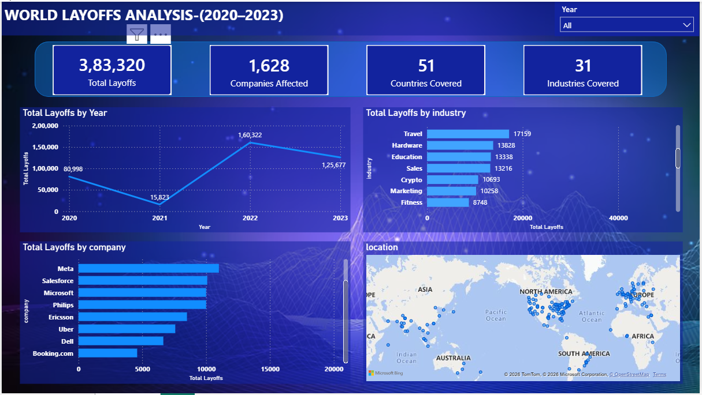

# world-layoffs-data-analysis2
Data cleaning and exploratory analysis of global layoffs using MySQL

## Project Overview
This project analyzes global company layoffs using MySQL. The current phase focuses on cleaning and preparing the dataset for exploratory data analysis.

## Tools & Technologies
- MySQL
- MySQL Workbench
- SQL

## Work Completed
- Created staging tables.
- Identified and removed duplicate records.
- Handled missing and NULL values.
- Standardized industry and country names.
- Converted date values into DATE format.
- Removed records with missing layoff information.

## Project Structure
- `SQL/` – SQL scripts for data cleaning and EDA.
- `Data/` – Cleaned dataset.
- `PowerBI/` – Dashboard files (to be added).

## Dashboard Preview

The following dashboard was created using Power BI to analyze global layoffs from 2020 to 2023.

## Key Insights
- Analyzed layoffs across different companies, industries and countries.
- Identified yearly layoff trends.
- Compared the top 10 companies by layoffs.
- Created interactive visualizations using Power BI.
